# **sistema de horarios planta docente**

## problema base

en X institucion educativa usan un metodo obsoleto en la administracion de los horarios en la planta docente, usando metodologias convencionales y procesos no automatizados, lo que dificulta la distribucion de las clases entre el personal docente de la institucion, generando cruces de horarios y errores en la asignacion de grupos y salones a cada docente. Esto ocasiona una desorganizacion y perdida de tiempo en la planificacion academica de la institucion educativa

## solucion propuesta

El **Sistema de Horarios de Planta Docente** es una aplicacion diseñada y orientada para facilitar la creacion, consulta y administracion de los horarios academicos de los docentes. Su proposito principal es centralizar la informacion correspondiente al personal docente de la institucion, las asignaturas, los grupos academicos, las jornadas y espacios de los horarios, facilitando su administracion mediante una plataforma organizada y accesible

La implementación de este sistema busca reducir la dependencia de metodologías convencionales y procedimientos manuales que pueden ocasionar inconsistencias en la información, duplicidad de asignaciones, cruces de horarios y dificultades para consultar o actualizar la planificación académica. Asimismo, pretende mejorar la disponibilidad de la información, agilizar las tareas administrativas y proporcionar una herramienta que contribuya a la toma de decisiones dentro de la institución educativa.

## valor del programa

El valor del Sistema de Gestión de Horarios de la Planta Docente radica en la optimización de los procesos administrativos y académicos mediante la centralización de la información, la automatización de tareas y la reducción de errores en la asignación de horarios. Su implementación permite mejorar la organización institucional, agilizar la consulta y actualización de datos, prevenir conflictos en la programación académica y facilitar la toma de decisiones, contribuyendo a una gestión más eficiente, precisa y confiable de los recursos humanos y físicos de la institución educativa.

## Arquitectura del sistema

```mermaid
flowchart TD
    U["Usuarios del sistema"]

    subgraph FE["Capa de presentación"]
        UI["Frontend: HTML, CSS y JavaScript"]
    end

    subgraph BE["Capa lógica de negocio"]
        API["Backend: Java"]
        VAL["Validación de horarios"]
        AUTH["Autenticación y permisos"]
    end

    subgraph DB["Capa de datos"]
        MYSQL[("Base de datos MySQL")]
    end

    U <--> UI
    UI <--> API
    API --> VAL
    API --> AUTH
    VAL <--> MYSQL
    AUTH <--> MYSQL

    style U fill:#17365D,color:#fff
    style UI fill:#DBEAFE,color:#1E3A8A
    style API fill:#DCFCE7,color:#14532D
    style VAL fill:#DCFCE7,color:#14532D
    style AUTH fill:#DCFCE7,color:#14532D
    style MYSQL fill:#FEF3C7,color:#92400E
```

## Modelo Entidad-Relación (MER)

El siguiente diagrama representa la estructura de la base de datos **SistemaHorariosDocentes**, incluyendo sus entidades, atributos, claves primarias, claves foráneas y relaciones.

